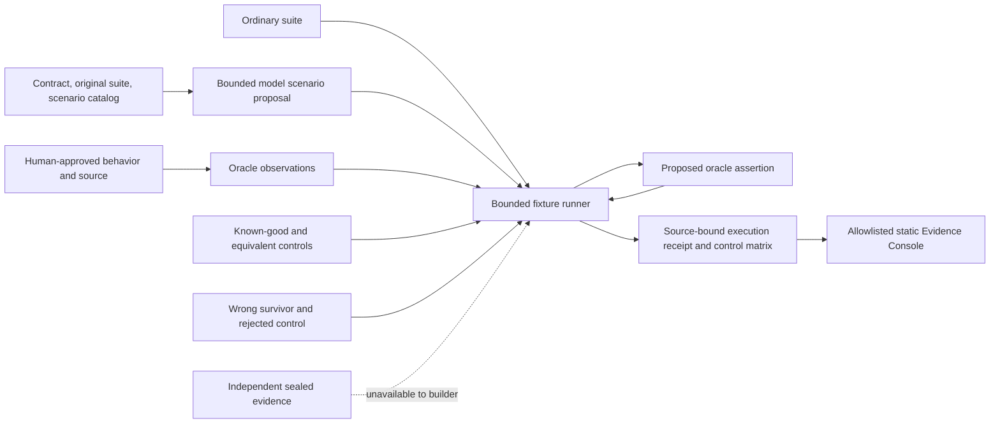

# CAT architecture description for judges

CAT separates the intended behavior, candidate proposal, deterministic evaluation, and public evidence projection.

The approved behavior and source authority define the comparison. For the offline Nemotron proposal workflow, the model receives only the H0-2 contract, original suite cases and four bounded scenario options. It does not receive candidate identities, control outcomes or the successful repair assertion. Its constrained scenario/observation proposal is locally checked against the contract and independently executed against all four implementations. The local simulation results are not provider output. A solver or model may propose an observation or patch but cannot bind consequential meaning or decide acceptance. The H0-2 tenant-export and synthetic idempotency demonstrations execute self-owned fixtures in bounded Node child processes; the runner records ordinary-suite and proposed-assertion outcomes against positive and negative controls. This is process control, not Docker-sealed isolation. The static Console projects allowlisted recorded evidence and does not execute candidates, access private holdouts, or call a provider.

The historical node-cache zero-TTL case is a separate recorded evidence path: its finite-expiry survivor and `expiresAt = 0` distinction were not freshly replayed. P03 remains historical and incomplete, P04 is omitted from the public Console, and the public oracle is WEAK. The diagram describes the product boundary, not a claim that every path was freshly executed or sealed in this release.
